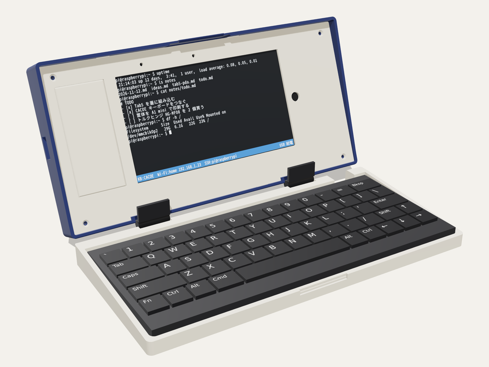
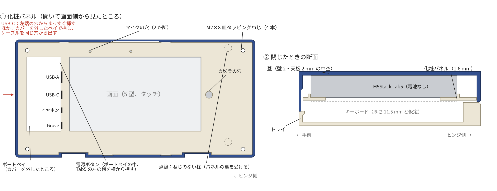

# Tab5 PDA Terminal

M5Stack Tab5（5 型タッチ液晶、ESP32-P4）と CACOE のキーボードを収める、クラムシェル型の筐体です。3D プリントで作ります。[PaperDIY PDA Terminal](https://github.com/tsuyoshi-otake/paperdiy-pda-terminal) の筐体を、画面を Tab5 に替えて作り直したものです。

**関連プロジェクト**：元になった PaperDIY 版（4.7 型 e-paper、ファームウェア付き）は、[PaperDIY PDA Terminal](https://github.com/tsuyoshi-otake/paperdiy-pda-terminal) にあります（トレイ・ヒンジ・留めツメは同じ形）。



## いまの状態

- **設計と印刷データまで**です。まだ 1 つも刷っていません。Tab5 の実物にも当てていません
- Tab5 の寸法は、M5Stack が公開している寸法図と筐体の 3D データから読んだものです（実測していません）
- 入っているのは**筐体だけ**です。ファームウェアはありません
- 土台にした PaperDIY 版は実機が 1 台組み上がっていますが、その最新の直し（ヒンジ側の逃がし、留めツメ）は、PaperDIY 版でもまだ刷って確かめていません

## どんな形か

| | |
| --- | --- |
| 外形（閉じたとき） | 幅 202 × 奥行き 99.5 × 高さ 29.8 mm（上面は平ら） |
| 画面 | Tab5（128 × 80 × 12 mm、電池なし）を、画面を下にして蓋に入れ、化粧パネルで押さえる。画面の窓は蓋の中央 |
| 電源 | Tab5 の USB-C に、蓋の左端の穴からまっすぐなプラグを挿す（モバイルバッテリーなど）。NP-F550 電池は付けられない |
| 端子 | Tab5 の左の縁の USB-A・USB-C・イヤホン（3.5 mm）・Grove（PORT.A）と電源ボタンが使える。USB-C は蓋の左端の穴（USB-C のプラグの大きさ、1 つ）からまっすぐ挿す。ほかのプラグは化粧パネルのカバーを外したところ（ポートベイ）から入れて挿し、ケーブルは同じ穴から出す。挿したままカバーを戻せる |
| キーボード | CACOE（元の作品と同じ 196 × 87 mm の空間） |
| ヒンジ | スガツネ HG-MF08（フリーストップのトルクヒンジ）2 個。カバーなしで、背面に板が面一に見える |
| 留め | 蓋と一体の留めツメ（幅 30 mm、磁石なし） |
| ねじ | M2×8 皿タッピング 12 本（ヒンジ 8、化粧パネルは四隅の 4） |
| 開く角度 | 机の上で 143°（蓋が机に当たるまで） |




- 化粧パネルには、画面の窓のほかに、カメラの穴、マイクの穴 2 つ、ポートベイの開口があります。開口は画面の窓と上下をそろえた長方形で（窓との間と、パネルの左の縁との間を同じ 7 mm に）、パネルと面一のはめ込みカバーで閉じます。カバーを外すと Tab5 の左の縁（電源ボタンと端子 4 つ）に手が届きます
- Tab5 の背面は、蓋の天板から下りるリブ 3 本で受けます。タッチで押す力はここで受けます
- 化粧パネルのねじは四隅の 4 本だけです。Tab5 の右では、ねじのない柱 2 本（天板から下りている）がパネルの裏を受けます。左はポートベイなので、柱を立てていません

## 設計の時点で分かっている弱点

刷る前に知っておいてほしいことです。数字は `cad/out/print_report.md` の計算です。

1. **タッチすると蓋が後ろへ動くことがあります**。Tab5 を入れた蓋は 220 g あり、HG-MF08 2 個の保持力（0.118〜0.196 N·m）に対して余裕がありません。画面の真ん中を押して蓋が動かない力は、120° に開いた状態で 1.1〜1.8 N、135° で 0.7〜1.4 N です（軽いタップは 0.5〜1 N 程度）。強く押すと、蓋は机に当たる 143° まで倒れていきます。もっと固いヒンジにするには、ヒンジの座を描き直す必要があります（未着手）
2. **キーボードが 156 g より軽いと、大きく開いたときに後ろへ倒れます**。120° までなら 102 g で足ります。キーボードの重さは量っていません
3. **使えるのは Tab5 の左の縁のもの（電源ボタン、USB-A、USB-C、イヤホン、Grove）だけ**です。microSD と拡張ピン（下の縁）、三脚ねじは蓋の中に隠れます。スピーカーも蓋の中に向いています
4. **電源ボタンもポートベイの中にあるので、押すときはカバーを外します**（指先を入れて横から押す）。押しやすいかどうかは刷ってみないと分かりません
5. **端子の位置は寸法図から読んだ値**です（±0.5 mm ほど）。USB-C と電源ボタンは、寸法図と筐体の 3D データが 0.4 mm 以内で合いました。USB-A・イヤホン・Grove は 3D データに穴がないので、寸法図だけが頼りです。蓋の左端の穴は、USB-C のプラグが通る大きさの穴 1 つ（13 × 7.5 mm、Tab5 の USB-C の正面）です。印刷で宙に渡す縁は 13 mm なので、サポートは要りません
6. **端子は蓋の左端から 38 mm 奥にあります**。USB-C は穴からまっすぐ差し込めば端子に届きます。ほかのプラグは、カバーを外したポートベイから入れて、指で端子に押し込みます。ケーブルは左端の同じ穴から出すので、ケーブルのどちらかの端が穴を通る必要があります（USB-C のプラグ、Grove のコネクタ、細めのイヤホンのプラグなど、12 × 7 mm くらいまで）。太さ 4 mm くらいのケーブルなら 3 本並びます。挿したままカバーを戻せます。端子に挿すのはまっすぐなプラグで、根元が USB-A 16 × 8 mm、USB-C 12 × 6.5 mm、イヤホン Ø7.5 mm、Grove 10 × 5 mm 以内のものです。L 字のプラグは入りません。USB-A のケーブルは、プラグの後ろから壁までの 8 mm で横に 8.5 mm 曲げて穴に寄せるので、細く柔らかいものにしてください。4 つ全部挿すと、隣どうしの隙間は 1 mm です
7. USB-A とイヤホンのプラグは Tab5 の背面より 0.4〜0.6 mm 出るので、その通り道の天板は内側から削って 1.2 mm にしてあります（外からは見えません）
8. キーボードの充電プラグを背面に挿したままだと、蓋は 98° までしか開きません

## 印刷

Bambu Lab A1 mini（0.4 mm ノズル、PLA、0.2 mm 積層、サポートなし）向けです。`cad/3mf/` にプレートごとの 3MF、`cad/3mf/bambu_a1mini/` に Bambu Studio のプロジェクトがあります。時間と重さは PrusaSlicer での見積もりです。

| プレート | 中身 | 時間・重さ |
| --- | --- | --- |
| `plate0_test_coupons.3mf` | 試し刷り（ヒンジの座、留めツメ、蓋の左端の穴） | 26 分・11 g |
| `plate1_lid.3mf` | 蓋 A・B、継ぎ板 1 枚 | 1 時間 56 分・72 g |
| `plate2_tray.3mf` | トレイ A・B、継ぎ板 1 枚 | 1 時間 31 分・61 g |
| `plate3_panel.3mf` | 化粧パネル A・B、ポートベイのカバー、継ぎ板 1 枚 | 38 分・24 g |
| 合計（plate 1〜3） | | 4 時間 3 分・157 g |

220 mm 以上のベッドなら、分割なしの `cad/3mf/large/`（合計 3 時間 52 分・156 g）が使えます。

A1 mini 用の分割は、蓋と化粧パネルが右端、トレイが左端です（蓋はポートベイの天板を切らないように右端で分けました）。

**トレイ（plate 2）は PaperDIY 版の最新のトレイと同じ**です（STL まで一致）。PaperDIY 版のカバーなしのトレイ（2026-11-15 以降）があれば、そのまま使えます。それより前のカバー付きのトレイは、ヒンジの板が 1 mm 深い位置にあるので、この蓋とは組み合わせられません。

## 組み立て

手順は [cad/ASSEMBLY_ja.md](cad/ASSEMBLY_ja.md)、部品表は [cad/bom.csv](cad/bom.csv) です。

## 作り直す

```sh
make setup      # Python のパッケージ（バージョン固定）
make 3mf        # 元の作品の STL を取得して、全部の STL と印刷プレートを作る（干渉・動きのチェックも走る）
make verify     # 作り直して、リポジトリにあるものと同じか確かめる
make report     # 印刷時間・重さ・ヒンジの保持力・倒れやすさ（PrusaSlicer が要る）→ cad/out/print_report.md
make sim        # 留めツメを閉じるところのシミュレーション → cad/out/snap_sim.md
make render     # 画像の描き直し（Node.js が要る）
```

寸法は `cad/src/params.py` にまとめてあります。設計の中身は [cad/README.md](cad/README.md)（英語）にあります。

## PaperDIY 版との違い

- 蓋：Tab5（12 mm）に合わせて高さを 29.8 mm にし、上面を平らにした。左端に USB-C のプラグの大きさの穴を 1 つ開け（USB-C はまっすぐ挿し、ほかの端子のケーブルも通す）、Tab5 との間をポートベイにした。化粧パネルのねじは四隅の 4 本のまま、Tab5 の右にねじのない柱を 2 本足した。留めツメのまわりの薄い帯は、壁が高くなった分、上端を下げて同じ高さ（11.9 mm）にした。A1 mini 用の分割は右端
- 化粧パネル：窓を 5 型の画面に、カメラとマイクの穴を追加、キーと電源ボタン用の切り欠きをやめて、左側にポートベイの開口（画面の窓と上下をそろえた長方形）とはめ込みのカバーを付けた
- トレイ、ヒンジ（カバーなし）、留めツメ、ヒンジ側の逃がし：PaperDIY 版のまま
- PaperDIY 版にあったメス端子用の蓋、ファームウェアは、ここにはない

## ライセンス

- スクリプトと文書：[MIT](LICENSE)
- 筐体のデータと画像（`cad/out/`、`cad/3mf/`、`cad/renders/`、`docs/images/`）：Un Kyu Lee さんの [phone-enclosure](https://github.com/unkyulee/phone-enclosure)（CC BY-NC 4.0）の改変物なので、**CC BY-NC 4.0（非営利のみ）**です。詳しくは [cad/LICENSE.md](cad/LICENSE.md)
- Tab5 の寸法は M5Stack の公開データ（[m5stack/M5_Hardware](https://github.com/m5stack/M5_Hardware)、MIT）から読みました。M5Stack、Tab5、スガツネ、CACOE は各社の名前で、このプロジェクトはどの会社とも関係ありません
