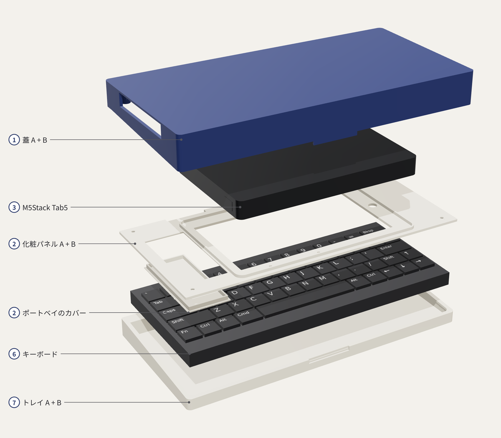

# Tab5 PDA Terminal

M5Stack Tab5（5 型タッチ液晶、ESP32-P4）と CACOE のキーボードを収める、クラムシェル型の筐体です。3D プリントで作ります。[PaperDIY PDA Terminal](https://github.com/tsuyoshi-otake/paperdiy-pda-terminal) の筐体を、画面を Tab5 に替えて作り直したものです。

**関連プロジェクト**：元になった PaperDIY 版（4.7 型 e-paper、ファームウェア付き）は、[PaperDIY PDA Terminal](https://github.com/tsuyoshi-otake/paperdiy-pda-terminal) にあります（トレイ・ヒンジ・留めツメは同じ形）。


## いまの状態

- **設計と印刷データまで**です。まだ 1 つも刷っていません。Tab5 の実物にも当てていません
- Tab5 の寸法は、M5Stack が公開している寸法図と筐体の 3D データから読んだものです（実測していません）
- 入っているのは**筐体だけ**です。ファームウェアはありません
- 土台にした PaperDIY 版は実機が 1 台組み上がっていますが、その最新の直し（ヒンジ側の逃がし、留めツメ）は、PaperDIY 版でもまだ刷って確かめていません

## どんな形か

| | |
| --- | --- |
| 外形（閉じたとき） | 幅 202 × 奥行き 99.5 × 高さ 29.8 mm（上面は平ら） |
| 画面 | Tab5（128 × 80 × 12 mm、電池なし）を、画面を下にして蓋に入れ、化粧パネルで押さえる。画面の窓は蓋の中央 |
| 電源 | Tab5 の USB-C に、蓋の左端の穴からまっすぐなプラグを挿す（モバイルバッテリーなど）。NP-F550 電池は付けられない |
| キーボード | CACOE（元の作品と同じ 196 × 87 mm の空間） |
| ヒンジ | スガツネ HG-MF08（フリーストップのトルクヒンジ）2 個 |
| 留め | 蓋と一体の留めツメ（幅 30 mm、磁石なし） |
| ねじ | M2×8 皿タッピング 12 本（ヒンジ 8、化粧パネルは四隅の 4） |
| 開く角度 | 机の上で 140°（蓋が机に当たるまで） |




- 化粧パネルには、画面の窓のほかに、カメラの穴、マイクの穴 2 つ、電源ボタンを横から押す切り欠き、USB-C プラグを端子まで導く切り欠きがあります
- Tab5 の背面は、蓋の天板から下りるリブ 3 本で受けます。タッチで押す力はここで受けます
- 化粧パネルのねじは四隅の 4 本だけです。Tab5 の左右では、ねじのない柱 4 本（天板から下りている）がパネルの裏を受けます

## 設計の時点で分かっている弱点

刷る前に知っておいてほしいことです。数字は `cad/out/print_report.md` の計算です。

1. **タッチすると蓋が後ろへ動くことがあります**。Tab5 を入れた蓋は 223 g あり、HG-MF08 2 個の保持力（0.118〜0.196 N·m）に対して余裕がありません。画面の真ん中を押して蓋が動かない力は、120° に開いた状態で 1.2〜1.9 N、135° で 0.7〜1.5 N です（軽いタップは 0.5〜1 N 程度）。強く押すと、蓋は机に当たる 140° まで倒れていきます。もっと固いヒンジにするには、ヒンジの座を描き直す必要があります（未着手）
2. **キーボードが 145 g より軽いと、大きく開いたときに後ろへ倒れます**。120° までなら 97 g で足ります。キーボードの重さは量っていません
3. **蓋の中で使えるのは USB-C と電源ボタンだけ**です。USB-A、イヤホン端子、microSD、Grove、拡張ピン、三脚ねじは蓋の中に隠れます。スピーカーも蓋の中に向いています
4. **電源ボタンは、切り欠き（11 × 15 mm）に指先を入れて横から押します**。押しやすいかどうかは刷ってみないと分かりません
5. **USB-C 端子の奥行き方向の位置**（画面から 8.2 mm 奥）は寸法図から読んだ値で、いちばん外れやすい寸法です。蓋の左端の穴は、その分の余裕を見て高さ 7.6 mm にしてあります
6. キーボードの充電プラグを背面に挿したままだと、蓋は 94° までしか開きません

## 印刷

Bambu Lab A1 mini（0.4 mm ノズル、PLA、0.2 mm 積層、サポートなし）向けです。`cad/3mf/` にプレートごとの 3MF、`cad/3mf/bambu_a1mini/` に Bambu Studio のプロジェクトがあります。時間と重さは PrusaSlicer での見積もりです。

| プレート | 中身 | 時間・重さ |
| --- | --- | --- |
| `plate0_test_coupons.3mf` | 試し刷り（ヒンジの座、留めツメ、カバー） | 28 分・11 g |
| `plate1_lid.3mf` | 蓋 A・B、蓋側のヒンジカバー 2 枚、継ぎ板 2 枚 | 2 時間 8 分・76 g |
| `plate2_tray.3mf` | トレイ A・B、トレイ側のヒンジカバー 2 枚、継ぎ板 1 枚 | 1 時間 32 分・62 g |
| `plate3_panel.3mf` | 化粧パネル A・B、継ぎ板 3 枚 | 35 分・23 g |
| 合計（plate 1〜3） | | 4 時間 15 分・160 g |

220 mm 以上のベッドなら、分割なしの `cad/3mf/large/`（合計 4 時間 3 分・159 g）が使えます。

**トレイ（plate 2）は PaperDIY 版の最新のトレイと同じ形**です（差は背面の縁の 0.1 mm ほどのかけらだけ）。PaperDIY 版のトレイ（2026-11-12 のストッパーなしの版）があれば、そのまま使えます。

## 組み立て

手順は [cad/ASSEMBLY_ja.md](cad/ASSEMBLY_ja.md)、部品表は [cad/bom.csv](cad/bom.csv) です。

## 作り直す

```sh
make setup      # Python のパッケージ（バージョン固定）
make 3mf        # 元の作品の STL を取得して、全部の STL と印刷プレートを作る（干渉・動きのチェックも走る）
make verify     # 作り直して、リポジトリにあるものと同じか確かめる
make report     # 印刷時間・重さ・ヒンジの保持力・倒れやすさ（PrusaSlicer が要る）→ cad/out/print_report.md
make sim        # 留めツメを閉じるところのシミュレーション → cad/out/snap_sim.md
make render     # 画像の描き直し（Node.js が要る）
```

寸法は `cad/src/params.py` にまとめてあります。設計の中身は [cad/README.md](cad/README.md)（英語）にあります。

## PaperDIY 版との違い

- 蓋：Tab5（12 mm）に合わせて高さを 29.8 mm にし、上面を平らにした。左端の USB-C の穴と中の案内を Tab5 の端子の位置に合わせた。化粧パネルのねじは四隅の 4 本のまま、Tab5 の脇にねじのない柱を 4 本足した。留めツメのまわりの薄い帯は、壁が高くなった分、上端を下げて同じ高さ（11.9 mm）にした
- 化粧パネル：窓を 5 型の画面に、カメラとマイクの穴を追加、キー用の切り欠きをやめて電源ボタン用の切り欠き 1 つに
- トレイ、ヒンジ、ヒンジカバー、留めツメ、ヒンジ側の逃がし：PaperDIY 版のまま
- PaperDIY 版にあったメス端子用の蓋、ファームウェアは、ここにはない

## ライセンス

- スクリプトと文書：[MIT](LICENSE)
- 筐体のデータと画像（`cad/out/`、`cad/3mf/`、`cad/renders/`、`docs/images/`）：Un Kyu Lee さんの [phone-enclosure](https://github.com/unkyulee/phone-enclosure)（CC BY-NC 4.0）の改変物なので、**CC BY-NC 4.0（非営利のみ）**です。詳しくは [cad/LICENSE.md](cad/LICENSE.md)
- Tab5 の寸法は M5Stack の公開データ（[m5stack/M5_Hardware](https://github.com/m5stack/M5_Hardware)、MIT）から読みました。M5Stack、Tab5、スガツネ、CACOE は各社の名前で、このプロジェクトはどの会社とも関係ありません
