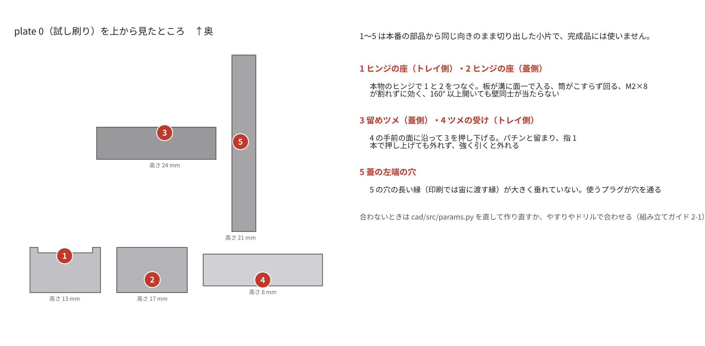
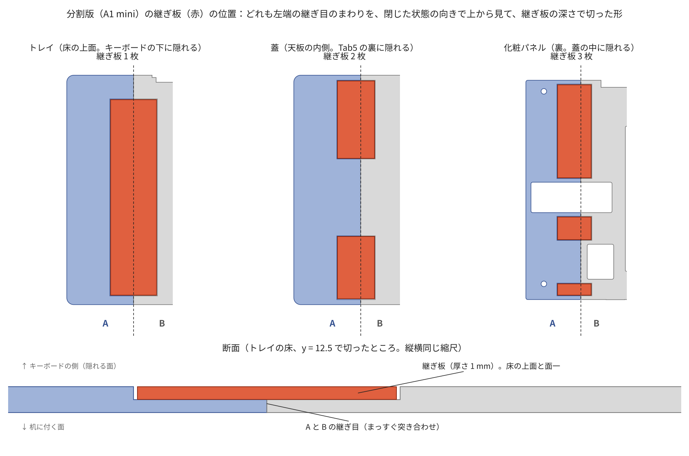
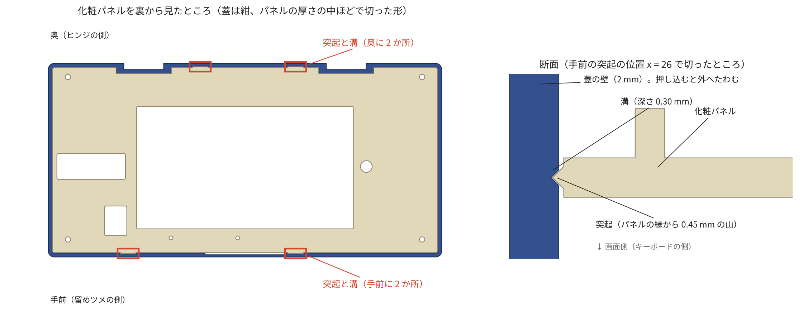

# 組み立てガイド（部品表・印刷・組み立て）

Tab5 PDA 筐体を Bambu Lab A1 mini で刷って組み立てる手順です。M5Stack Tab5 は**電池（NP-F550）を付けずに**、中空の蓋に画面を下にして入れ、化粧パネルで押さえます。

**この版は、まだ刷って確かめていません。**Tab5 の寸法もメーカーの図面から読んだものです。先に試し刷り（2-1）をして、蓋と化粧パネルを刷ったら、ねじを締める前に Tab5 を当てて収まりを確かめてください。合わなかったところは [5 章](#5-確認リスト考慮しきれていない点) の表を見てください。

## 1. 部品表

図の番号と同じです。表計算ソフトで開ける CSV 版：[bom.csv](bom.csv)

| 番号 | 部品 | 数 | 種類 | 注意 |
| --- | --- | --- | --- | --- |
| 1 | 蓋 A・B | 1 組 | 印刷 | 一体の版では 1 個（2-3） |
| 2 | 化粧パネル A・B | 1 組 | 印刷 | 画面の窓、カメラ・マイクの穴、電源ボタンと USB-C の切り欠き付き |
| 3 | M5Stack Tab5 | 1 | 購入 | **電池なし**（本体だけ、128 × 80 × 12 mm、120.9 g）。電池付きのキットなら、電池を外して使う |
| 4 | トルクヒンジ スガツネ HG-MF08 | 2 | 購入 | 白 -WT でも黒 -BL でも可（カバーで隠れる） |
| 5 | ヒンジカバー | 4 | 印刷 | 蓋側 2、トレイ側 2。背面のくぼみに面一にはめ、ヒンジのねじで共締めする |
| 6 | CACOE キーボード | 1 | 購入 | **重さ**と**寸法**を先に確かめる（3-1） |
| 7 | トレイ A・B | 1 組 | 印刷 | PaperDIY 版の最新のトレイと同じ形 |
| – | 継ぎ板 | 6 | 印刷 | **分割版だけ**。蓋 2・トレイ 1・化粧パネル 3。継ぎ目を裏から貼る（3-2） |
| 8 | **M2×8 皿タッピングねじ**（樹脂用 1 種 または B タイト） | **12** | 購入 | ヒンジ 8（カバーごと留める）、化粧パネル 4（四隅） |
| – | USB-C ケーブル | 1 | 手持ち | 給電用。**まっすぐなプラグ**で、根元の太い部分が幅 12 mm × 厚さ 6.5 mm 以内のもの |
| – | モバイルバッテリーなど USB の電源 | 1 | 手持ち | Tab5 は USB-C から給電する |
| – | 瞬間接着剤（ゼリー状）またはエポキシ | 少し | 購入 | 継ぎ目と継ぎ板（分割版だけ） |
| – | はがせる薄い両面テープ | 少し | 任意 | キーボードがトレイの中で動くのが気になるとき |

ねじは **M2×8 皿タッピングねじ 1 種類だけ**です。

**工具**：プラスドライバー（#0 か #1）、ニッパー、平やすり、ノギス、キッチンスケール（キーボードの重さ）。

## 2. 印刷（Bambu Lab A1 mini、または大きいプリンター）

PLA、0.4 mm ノズル、積層 0.2 mm、サポートなしです。部品はすでに印刷する向きで 180 × 180 mm のプレートに並んでいます。

### 2-0. 設定入りのプロジェクトを開く

`3mf/bambu_a1mini/` に、Bambu Studio のプロジェクトがあります（`bambu_plate0_test_coupons.3mf` 〜 `bambu_plate3_panel.3mf`）。Bambu Studio（2.0 以降）の「ファイル → プロジェクトを開く」で開くと、プリンタ・プロセス・フィラメントが選ばれた状態になります。

| 欄 | 開いたときの状態 |
| --- | --- |
| プリンタ | Bambu Lab A1 mini 0.4 nozzle |
| プレート | Textured PEI Plate |
| フィラメント | Bambu PLA Basic |
| プロセス | 0.20mm Standard @BBL A1M から 5 か所を変えたもの：壁のループ数 3、インフィルのパターン ジャイロイド、壁面生成器 Arachne、象足補正 0.1 mm、正確な Z の高さ オン |

- **開いたら、この 4 つの欄が表のとおりか確かめてください。**このファイルは Bambu Studio の読み込み処理（公開されているソース）に合わせて作ったもので、作る側の環境では Bambu Studio を動かして確かめられていません
- うまく入らないときは、`3mf/` の形だけのファイルを開き、`3mf/bambu_a1mini/tab5_process_a1mini_04.json` を「ファイル → インポート → 設定のインポート」で取り込んで、プロセスの一覧から「Tab5 PDA 0.20mm @BBL A1M」を選びます
- ほかのプリンタでは、`3mf/` の形だけのファイルを使い、プロセスを上の表の 5 か所に合わせて、サポートなしで刷ります

### 2-1. まず試し刷り（plate 0、約 28 分・11 g）

`plate0_test_coupons.3mf` は、本番の部品から**同じ向きのまま切り出した小片**です。小片は完成品には使いません。

| 小片 | 確かめること | 合わないとき（`src/params.py` を変えて作り直す） |
| --- | --- | --- |
| ヒンジ（トレイ側・蓋側の 2 個） | 本物の HG-MF08 とカバーを付けて M2×8 で締め、板が溝に収まる、カバーが背面と面一になる、筒がこすらずに回る、ねじが割れずに効く | 溝がきつい・ゆるい → `HINGE_CLR`、筒が当たる → `HINGE_BARREL_D`、ねじ → `HINGE_PILOT_D` |
| 留めツメ（蓋側・トレイ側の 2 個、幅 45 mm） | 蓋側の小片を、トレイ側の小片の手前の壁にかぶせて押し下げる。**カチッと留まり**、指 1 本で押し上げても外れず、強く引き上げると外れる | カチッと言わない・軽く押すと外れる → `LATCH["bump"]`（標準 0.45 mm）を 0.05 mm ずつ上げる。固くて開けにくい → 出っ張りの上側の斜面を紙やすりで少し削るか、`bump` を下げる |
| ヒンジカバー 2 枚 | ヒンジの小片のくぼみに指で押し込めて、ねじなしでも逆さにして落ちない | 押し込めない・すぐ落ちる → `COVER_RIBS["h"]`（標準 0.35 mm）を 0.05 mm ずつ変える |

### 2-2. 本番（plate 1〜3、PLA 約 160 g、約 4 時間 15 分）

| ファイル | 中身 | 時間・重さ |
| --- | --- | --- |
| `plate1_lid.3mf` | 蓋 A・B、蓋側ヒンジカバー 2 枚、蓋の継ぎ板 2 枚 | 2 時間 8 分・76 g |
| `plate2_tray.3mf` | トレイ A・B、トレイ側ヒンジカバー 2 枚、トレイの継ぎ板 1 枚 | 1 時間 32 分・62 g |
| `plate3_panel.3mf` | 化粧パネル A・B、パネルの継ぎ板 3 枚 | 35 分・23 g |

- 蓋は天面を下、トレイは底を下、化粧パネルは見える面を下にして刷ります（3MF でその向きにしてあります）
- **蓋と化粧パネルを刷ったら、接着やねじ止めの前に Tab5 を当ててください**。見るのは、Tab5 が化粧パネルの裏の枠（128.4 × 80.4 mm）に入るか、窓が画面に合うか、蓋の左端の穴と USB-C 端子の高さが合うか、の 3 つです

### 2-3. 大きいプリンターで刷る（分割なし）

220 × 220 mm 以上のベッドなら、`3mf/large/` の一体の部品が使えます（蓋 2 時間 3 分・75 g、トレイ 1 時間 28 分・61 g、化粧パネル 33 分・23 g。合計 約 4 時間 3 分・159 g）。継ぎ板と接着は要りません。

## 3. 組み立て

### 3-1. 印刷・購入の前に確かめる

- **キーボードの重さ**：145 g 以上なら、蓋を机に当たるまで（140°）開いても倒れません。97 g 以上なら 120° まで大丈夫です。軽いときは、トレイの床におもりを貼るか、開きすぎないようにします
- **キーボードの寸法**：トレイの空間は 196 × 87 mm、キーボードの厚さは 11.5 mm と仮定しています（`KB_THICK`。厚いと蓋が閉まりません）
- **USB-C ケーブルのプラグ**：まっすぐで、根元が 12 × 6.5 mm 以内のもの。蓋の左端の穴（13 × 7.6 mm）を通します

### 3-2. 分割部品を貼り合わせる（A1 mini 用の分割版だけ）

蓋・トレイ・化粧パネルはどれも左端で 2 つに分かれていて、継ぎ目はまっすぐな突き合わせです。継ぎ目をまたぐ**継ぎ板**を見えない側のくぼみに貼って補強します。

| 部品 | 継ぎ板 | 貼る面 |
| --- | --- | --- |
| トレイ | 1 枚（20 × 84.8 mm、厚さ 1.0 mm） | 床の上面（キーボードの下に隠れる） |
| 蓋 | 2 枚（16 × 27 mm、16 × 33.5 mm、厚さ 1.0 mm） | 天板の内側。USB-C の通り道の両側 |
| 化粧パネル | 3 枚（14.5 × 4.8 / 9.8 / 40.3 mm、厚さ 0.8 mm） | 裏（蓋の中に隠れる）。切り欠きを避けてある |

1. まず接着剤なしで A と B を突き合わせ、継ぎ板をくぼみに置いてみます。きつければ継ぎ板の縁をやすりで少し削ります
2. 平らな板の上に、**見える面を下にして**置きます。外側の面がそろうように押さえながら、突き合わせ面に接着剤を付けて貼ります
3. 継ぎ板の裏に接着剤を薄く広げ、くぼみにはめて指で押さえます。はみ出した接着剤は拭き取ります
4. 接着剤が固まるまで動かさないでおきます

### 3-3. ヒンジとカバーを付ける

1. トレイの上に蓋を閉じて、外周をそろえます。手前の留めツメがトレイのくぼみに入って、パチンと留まります
2. 背面の 2 か所の溝に HG-MF08（④）を入れます。**ヒンジの平らな面（裏）を溝の底に当て、筒が外に出る向き**にします
3. ヒンジカバー（⑤）を、板の上のくぼみに指で押し込みます。上が蓋側、下がトレイ側です
4. M2×8 皿タッピングねじ（⑧）を、1 つのヒンジにつき 4 本（蓋側 2、トレイ側 2）、合計 8 本締めます。頭がカバーの皿穴に沈んで面一になったところで止め、締めすぎないでください
5. 蓋を開け閉めして、引っかかりがないか、好きな角度で止まるかを確かめます
   - **ねじを締めると蓋の手前が開く場合**：蓋とトレイの縁が、ヒンジのそばで先に当たっています。この蓋は下面をヒンジに向かって 0.4 mm まで斜めに逃がしてあるので、起きないはずです。起きたら、蓋の奥の縁（トレイに当たる面）を紙やすりで少し落とします

### 3-4. Tab5 と化粧パネルを付ける

1. 蓋を 100° くらいまで開き、蓋の内側（中空の側）をこちらに向けます
2. Tab5（③）を、**画面をこちらに向けて**蓋の中に入れます。**USB-C のある縁を左**にします（画面は普通に読める向きになります）。裏は天板の 3 本のリブに当たります。microSD を使うなら、先に挿しておきます（組んだあとは抜き差しできません）
3. 化粧パネル（②）をかぶせます。パネルの裏の枠が Tab5 のまわりに入り、窓が画面にそろいます。手前と奥の縁を指で押し込むと、パネルの縁の小さな突起 4 か所が蓋の壁の溝にパチンとはまります

   

4. M2×8 皿タッピングねじ（⑧）4 本で、パネルの四隅を蓋のボスに留めます。頭がパネルの皿穴に沈むところで止めます。Tab5 の左右では、ねじのない柱 4 本がパネルの裏を受けます（図の点線の丸）。Tab5 はパネルとリブの間に挟まって動かなくなります（すき間は 0.2 mm）
5. **USB-C**：蓋の左端の穴から、まっすぐなプラグを差し込みます。化粧パネルの左に、プラグの通り道を見せる切り欠きがあるので、プラグが端子に入るのを見ながら指で押し込めます。挿したまま蓋を閉じられます
6. **電源ボタン**：窓の左上の切り欠きに指先を入れて、Tab5 の左の縁のボタンを横（右向き）に押します。1 回押すと入り、2 回続けて押すと切れます

### 3-5. 仕上げ

- **キーボード（⑥）**：トレイ（⑦）のデッキの穴（196 × 87 mm）から、上から入れます。位置決めはなく、前後・左右に 2 mm ほど動きます。気になるときは、裏に両面テープを貼って床に留めます
- 背面の右寄りにある開口は、キーボードの充電口です。プラグを挿したままだと、蓋は 94° までしか開きません

## 4. 使うとき

- **閉じる**：蓋の手前を、留めツメがカチッと言うまで押し込みます（計算では約 10 N）
- **開ける**：片手で本体（トレイ）を押さえ、もう片方の手で蓋の手前の合わせ目に指先を掛けて持ち上げます
- **タッチ**：画面を強く押すと、蓋が後ろへ動くことがあります（ヒンジの保持力に余裕がありません）。蓋を机に当たるまで（140°）開いて使えば、それ以上は動きません
- **留めツメが掛からない・すぐ開くとき**：ヒンジのねじを少し緩めて閉じたままになるなら、3-3 の 5 の状態です。そうでなければ、閉じた蓋の手前の面がトレイより前に出ていないかを見ます。0.2 mm 以上出ているなら、段差を測って、その分だけツメの位置を動かしたデータに直します

## 5. 確認リスト（考慮しきれていない点）

| | 何が不確かか | 合わなかったとき |
| --- | --- | --- |
| 1 | USB-C 端子の奥行きの位置（画面から 8.2 mm 奥と読んだ） | `KIT_USB_Z` と `USB_CH`（穴は画面から 4.4〜12.0 mm）を直す。蓋 A だけ刷り直せば済む |
| 2 | 画面の窓の位置と大きさ（表示領域 110.7 × 62.3 mm、Tab5 の中心から左へ 2.8 mm・上へ 0.6 mm） | `KIT_WIN`、`KIT_WIN_OFF`、`KIT_WIN_OFF_Y`。化粧パネルだけ刷り直す |
| 3 | 電源ボタンの位置（左の縁、上端から 7.5〜16.7 mm）と、切り欠きからの押しやすさ | `KIT_PWR_CAP_Y`、`PANEL_SLOT`。化粧パネルだけ刷り直す |
| 4 | カメラとマイクの穴の位置 | `KIT_CAMERA`、`KIT_MICS`。化粧パネルだけ |
| 5 | Tab5 の裏の形（リブが当たる所が平らか） | `KIT_RIBS_X`。蓋を刷り直す。リブをニッパーで切ってもよい |
| 6 | タッチで蓋が動く | 使い方で避ける（4 章）。固いヒンジにするには、ヒンジの座の設計が要る |
| 7 | キーボードの重さ・寸法 | 3-1 |
| 8 | 留めツメ、ヒンジ側の逃がし | PaperDIY 版でも、最新の形はまだ刷って確かめていない |
