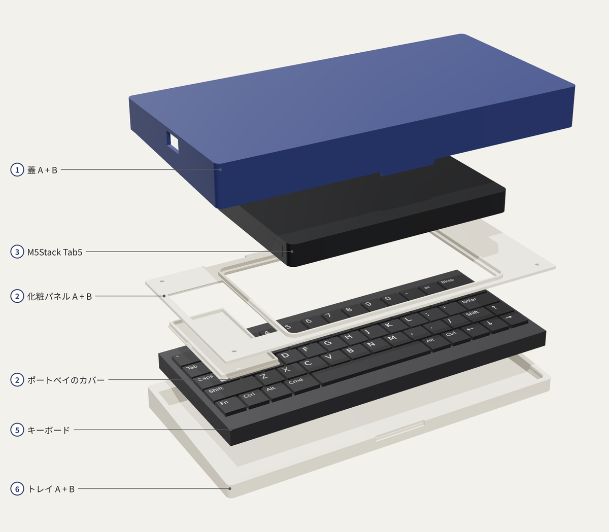
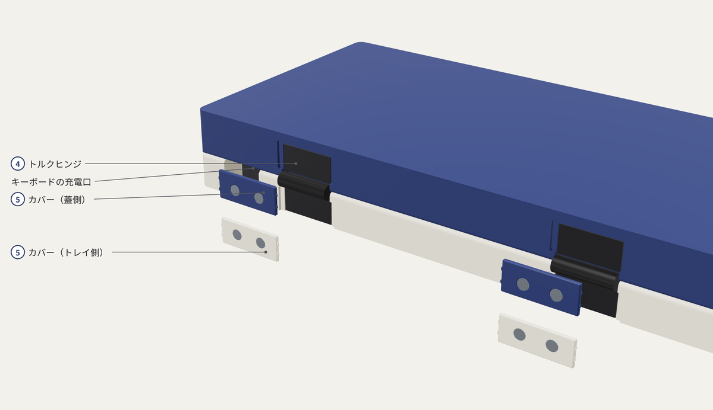
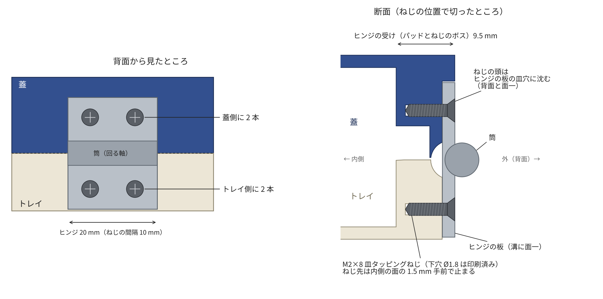
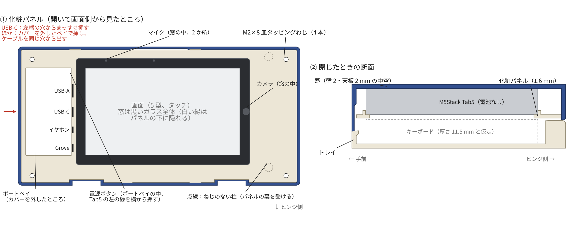

# 組み立てガイド（部品表・印刷・組み立て）

Tab5 PDA 筐体を Bambu Lab A1 mini で刷って組み立てる手順です。M5Stack Tab5 は**電池（NP-F550）を付けずに**、中空の蓋に画面を下にして入れ、化粧パネルで押さえます。

**この版は、まだ刷って確かめていません。**Tab5 の寸法もメーカーの図面から読んだものです。先に試し刷り（2-1）をして、蓋と化粧パネルを刷ったら、ねじを締める前に Tab5 を当てて収まりを確かめてください。合わなかったところは [5 章](#5-確認リスト考慮しきれていない点) の表を見てください。

## 1. 部品表

図の番号と同じです。表計算ソフトで開ける CSV 版：[bom.csv](bom.csv)

| 番号 | 部品 | 数 | 種類 | 注意 |
| --- | --- | --- | --- | --- |
| 1 | 蓋 A・B | 1 組 | 印刷 | 一体の版では 1 個（2-3） |
| 2 | 化粧パネル A・B、ポートベイのカバー | 1 組 | 印刷 | Tab5 の黒いガラス面が全部見える窓（白い縁は隠れる）、左側のポートベイ（電源ボタンと端子に手が届く開口）付き。カバーは右の縁を引っかけ、左の縁のツメで留める |
| 3 | M5Stack Tab5 | 1 | 購入 | **電池なし**（本体だけ、128 × 80 × 12 mm、120.9 g）。電池付きのキットなら、電池を外して使う |
| 4 | トルクヒンジ スガツネ HG-MF08 | 2 | 購入 | 白 -WT か黒 -BL（カバーはないので、背面に板が見える。ケースの色に合わせて選ぶ） |
| 5 | CACOE キーボード | 1 | 購入 | **重さ**と**寸法**を先に確かめる（3-1） |
| 6 | トレイ A・B | 1 組 | 印刷 | PaperDIY 版の最新のトレイと同じ形 |
| – | 継ぎ板 | 3 | 印刷 | **分割版だけ**。蓋 1・トレイ 1・化粧パネル 1。継ぎ目を裏から貼る（3-2） |
| 7 | **M2×8 皿タッピングねじ**（樹脂用 1 種 または B タイト） | **12** | 購入 | ヒンジ 8（頭はヒンジの板の皿穴に沈む）、化粧パネル 4（四隅） |
| – | USB-C ケーブル | 1 | 手持ち | 給電用。**まっすぐなプラグ**で、根元の太い部分が幅 12 mm × 厚さ 6.5 mm 以内のもの。蓋の左端の穴からまっすぐ挿す |
| – | USB-A・イヤホン・Grove のケーブル | 任意 | 手持ち | 使うものだけ。**まっすぐなプラグ**で、根元が USB-A 16 × 8 mm、イヤホン Ø7.5 mm、Grove 10 × 5 mm 以内のもの。どちらかの端が蓋の左端の穴（13 × 7.5 mm）を通ること（3-1） |
| – | モバイルバッテリーなど USB の電源 | 1 | 手持ち | Tab5 は USB-C から給電する |
| – | 瞬間接着剤（ゼリー状）またはエポキシ | 少し | 購入 | 継ぎ目と継ぎ板（分割版だけ） |
| – | はがせる薄い両面テープ | 少し | 任意 | キーボードがトレイの中で動くのが気になるとき |

ねじは **M2×8 皿タッピングねじ 1 種類だけ**です。

**工具**：プラスドライバー（#0 か #1）、ニッパー、平やすり、ノギス、キッチンスケール（キーボードの重さ）。

## 2. 印刷（Bambu Lab A1 mini、または大きいプリンター）

PLA、0.4 mm ノズル、積層 0.2 mm、サポートなしです。部品はすでに印刷する向きで 180 × 180 mm のプレートに並んでいます。

### 2-0. 設定入りのプロジェクトを開く

`3mf/bambu_a1mini/` に、Bambu Studio のプロジェクトがあります（`bambu_plate0_test_coupons.3mf` 〜 `bambu_plate3_panel.3mf`）。Bambu Studio（2.0 以降）の「ファイル → プロジェクトを開く」で開くと、プリンタ・プロセス・フィラメントが選ばれた状態になります。

| 欄 | 開いたときの状態 |
| --- | --- |
| プリンタ | Bambu Lab A1 mini 0.4 nozzle |
| プレート | Textured PEI Plate |
| フィラメント | Bambu PLA Basic |
| プロセス | 0.20mm Standard @BBL A1M から 5 か所を変えたもの：壁のループ数 3、インフィルのパターン ジャイロイド、壁面生成器 Arachne、象足補正 0.1 mm、正確な Z の高さ オン |

- **開いたら、この 4 つの欄が表のとおりか確かめてください。**このファイルは Bambu Studio の読み込み処理（公開されているソース）に合わせて作ったもので、作る側の環境では Bambu Studio を動かして確かめられていません
- うまく入らないときは、`3mf/` の形だけのファイルを開き、`3mf/bambu_a1mini/tab5_process_a1mini_04.json` を「ファイル → インポート → 設定のインポート」で取り込んで、プロセスの一覧から「Tab5 PDA 0.20mm @BBL A1M」を選びます
- ほかのプリンタでは、`3mf/` の形だけのファイルを使い、プロセスを上の表の 5 か所に合わせて、サポートなしで刷ります

### 2-1. まず試し刷り（plate 0、約 26 分・11 g）

`plate0_test_coupons.3mf` は、本番の部品から**同じ向きのまま切り出した小片**です。小片は完成品には使いません。

| 小片 | 確かめること | 合わないとき（`src/params.py` を変えて作り直す） |
| --- | --- | --- |
| ヒンジ（トレイ側・蓋側の 2 個） | 本物の HG-MF08 を M2×8 で締め、板が溝に収まって背面と面一になる、筒がこすらずに回る、ねじが割れずに効く | 溝がきつい・ゆるい → `HINGE_CLR`、筒が当たる → `HINGE_BARREL_D`、ねじ → `HINGE_PILOT_D` |
| 留めツメ（蓋側・トレイ側の 2 個、幅 45 mm） | 蓋側の小片を、トレイ側の小片の手前の壁にかぶせて押し下げる。**カチッと留まり**、指 1 本で押し上げても外れず、強く引き上げると外れる | カチッと言わない・軽く押すと外れる → `LATCH["bump"]`（標準 0.45 mm）を 0.05 mm ずつ上げる。固くて開けにくい → 出っ張りの上側の斜面を紙やすりで少し削るか、`bump` を下げる |
| 蓋の左端の穴（1 個、長さ 23 mm） | USB-C のプラグが穴をまっすぐ通る。ほかのケーブルの、穴に通すほうの端（USB-C のプラグ、Grove のコネクタ、イヤホンのプラグなど）も通る | 通らない → 穴をやすりで広げるか、`KIT_PORTS` の USB-C の `plug` を大きくする |

### 2-2. 本番（plate 1〜3、PLA 約 158 g、約 4 時間 3 分）

| ファイル | 中身 | 時間・重さ |
| --- | --- | --- |
| `plate1_lid.3mf` | 蓋 A・B、蓋の継ぎ板 1 枚 | 1 時間 56 分・72 g |
| `plate2_tray.3mf` | トレイ A・B、トレイの継ぎ板 1 枚 | 1 時間 31 分・61 g |
| `plate3_panel.3mf` | 化粧パネル A・B、ポートベイのカバー、パネルの継ぎ板 1 枚 | 39 分・25 g |

- 蓋は天面を下、トレイは底を下、化粧パネルは見える面を下にして刷ります（3MF でその向きにしてあります）
- **蓋と化粧パネルを刷ったら、接着やねじ止めの前に Tab5 を当ててください**。見るのは、Tab5 が化粧パネルの裏の枠（128.4 × 80.4 mm）に入るか、窓から黒いガラス面が全部見えて白い縁が隠れるか、蓋の左端の穴が Tab5 の USB-C の正面に来るか、の 3 つです

### 2-3. 大きいプリンターで刷る（分割なし）

220 × 220 mm 以上のベッドなら、`3mf/large/` の一体の部品が使えます（蓋 1 時間 51 分・71 g、トレイ 1 時間 26 分・61 g、化粧パネルとカバー 36 分・25 g。合計 約 3 時間 52 分・157 g）。継ぎ板と接着は要りません。

## 3. 組み立て

### 3-1. 印刷・購入の前に確かめる

- **キーボードの重さ**：157 g 以上なら、蓋を机に当たるまで（143°）開いても倒れません。102 g 以上なら 120° まで大丈夫です。軽いときは、トレイの床におもりを貼るか、開きすぎないようにします
- **キーボードの寸法**：トレイの空間は 196 × 87 mm、キーボードの厚さは 11.5 mm と仮定しています（`KB_THICK`。厚いと蓋が閉まりません）
- **ケーブルのプラグ**：端子に挿す側は、どれも**まっすぐなプラグ**で、根元（樹脂の太い部分）が次の大きさ以内のもの。L 字のプラグは入りません。端子は蓋の左端から 38 mm 奥にあります。USB-C は蓋の左端の穴からまっすぐ挿します。ほかはポートベイで挿して、ケーブルを左端の同じ穴（13 × 7.5 mm）から出すので、**ケーブルのどちらかの端がこの穴を通ること**（USB-C のプラグ、Grove のコネクタ、細めのイヤホンのプラグなど、12 × 7 mm くらいまで）。太さ 4 mm くらいのケーブルなら 3 本並びます
  - USB-A：16 × 8 mm（USB メモリや無線ドングルは、長さ 38 mm までなら蓋の中に収まります）。ケーブルはプラグの後ろから壁までの 8 mm で横に 8.5 mm 曲がって穴に寄るので、細く柔らかいもの
  - USB-C：12 × 6.5 mm
  - イヤホン（3.5 mm、4 極）：太さ Ø7.5 mm
  - Grove（HY2.0 4 ピン）：10 × 5 mm

### 3-2. 分割部品を貼り合わせる（A1 mini 用の分割版だけ）

トレイは左端、蓋と化粧パネルは右端で 2 つに分かれていて（左端のポートベイを切らないため）、継ぎ目はまっすぐな突き合わせです。蓋と化粧パネルの継ぎ目は同じ位置（右端から 29 mm）にそろえてあるので、画面側から見ると 1 本の線になります。継ぎ目をまたぐ**継ぎ板**を見えない側のくぼみに貼って補強します。

| 部品 | 継ぎ板 | 貼る面 |
| --- | --- | --- |
| トレイ | 1 枚（20 × 84.8 mm、厚さ 1.0 mm） | 床の上面（キーボードの下に隠れる） |
| 蓋 | 1 枚（16 × 70 mm、厚さ 1.0 mm） | 天板の内側（右端。Tab5 の右の 2 本の柱の間） |
| 化粧パネル | 1 枚（12 × 84 mm、厚さ 0.8 mm） | 裏（蓋の中に隠れる）。右端、Tab5 を囲む枠の外 |

1. まず接着剤なしで A と B を突き合わせ、継ぎ板をくぼみに置いてみます。きつければ継ぎ板の縁をやすりで少し削ります
2. 平らな板の上に、**見える面を下にして**置きます。外側の面がそろうように押さえながら、突き合わせ面に接着剤を付けて貼ります
3. 継ぎ板の裏に接着剤を薄く広げ、くぼみにはめて指で押さえます。はみ出した接着剤は拭き取ります
4. 接着剤が固まるまで動かさないでおきます

### 3-3. ヒンジを付ける

1. トレイの上に蓋を閉じて、外周をそろえます。手前の留めツメがトレイのくぼみに入って、パチンと留まります
2. 背面の 2 か所の溝に HG-MF08（④）を入れます。**ヒンジの平らな面（裏）を溝の底に当て、筒が外に出る向き**にします。板は背面と面一になります
3. M2×8 皿タッピングねじ（⑦）を、1 つのヒンジにつき 4 本（蓋側 2、トレイ側 2）、合計 8 本締めます。頭がヒンジの板の皿穴に沈んだところで止め、締めすぎないでください
4. 蓋を開け閉めして、引っかかりがないか、好きな角度で止まるかを確かめます
   - **ねじを締めると蓋の手前が開く場合**：蓋とトレイの縁が、ヒンジのそばで先に当たっています。この蓋は下面をヒンジに向かって 0.4 mm まで斜めに逃がしてあるので、起きないはずです。起きたら、蓋の奥の縁（トレイに当たる面）を紙やすりで少し落とします

### 3-4. Tab5 と化粧パネルを付ける

1. 蓋を 100° くらいまで開き、蓋の内側（中空の側）をこちらに向けます
2. Tab5（③）を、**画面をこちらに向けて**蓋の中に入れます。**USB-C のある縁を左**にします（画面は普通に読める向きになります）。裏は天板の 3 本のリブに当たります。microSD を使うなら、先に挿しておきます（組んだあとは抜き差しできません）
3. 化粧パネル（②）をかぶせます。パネルの裏の枠が Tab5 のまわりに入り、窓から Tab5 の黒いガラス面が全部見えます（白い縁はパネルの下）。手前と奥の縁を指で押し込むと、パネルの縁の小さな突起 4 か所が蓋の壁の溝にパチンとはまります

   

4. M2×8 皿タッピングねじ（⑦）4 本で、パネルの四隅を蓋のボスに留めます。頭がパネルの皿穴に沈むところで止めます。Tab5 の右では、ねじのない柱 2 本がパネルの裏を受けます（図の点線の丸）。Tab5 はパネルとリブの間に挟まって動かなくなります（すき間は 0.2 mm）
5. **ポートベイのカバー**：化粧パネルの左の長方形の開口（**ポートベイ**）を閉じます。電池のふたと同じ付け方です
   - **付ける**：カバーを少し傾け、右の縁（Tab5 の画面の側）を先に開口に入れて、裏の引っかけを化粧パネルの縁の下に差し込みます。そのまま左の縁を押し込むと、左の縁のツメ（表に細い切れ込みが見えるところ）がカチッと留まります。開口の裏の 45° の受けに乗るので、押し込みすぎることはありません
   - **外す**：左の縁の面取りに爪を掛けて、手前に起こします（ツメが内側にたわんで外れます）。左の縁が浮いたら、右の縁の引っかけを抜きます
6. **端子（USB-A、USB-C、イヤホン、Grove）**：蓋の左端に、USB-C のプラグが通る大きさの穴（13 × 7.5 mm）が 1 つ、Tab5 の USB-C の正面にあります
   - **USB-C**：プラグを穴からまっすぐ差し込むと、そのまま端子に入ります。入りにくいときは、カバーを外してベイの中で指で合わせます
   - **USB-A・イヤホン・Grove**：カバーを外し、ケーブルの端子に挿さないほうの端を、ベイの中から左端の穴に通して外へ引き出します（イヤホンは逆に、プラグを外から穴に通してベイに入れます）。プラグをベイの中で端子に合わせ、まっすぐ押し込みます。USB-A のように長いプラグは、後ろの端から化粧パネルの左の縁の下に入れると、ベイに収まります
   - 抜くときは、ベイの中でプラグをつまんで引きます。挿したままカバーを戻せ、蓋も閉じられます。ケーブルはどれも左端の穴から出ます
7. **電源ボタン**：カバーを外し、ポートベイの上の端に指先を入れて、Tab5 の左の縁のボタンを横（右向き）に押します。1 回押すと入り、2 回続けて押すと切れます

### 3-5. 仕上げ

- **キーボード（⑤）**：トレイ（⑥）のデッキの穴（196 × 87 mm）から、上から入れます。位置決めはなく、前後・左右に 2 mm ほど動きます。気になるときは、裏に両面テープを貼って床に留めます
- 背面の右寄りにある開口は、キーボードの充電口です。プラグを挿したままだと、蓋は 98° までしか開きません

## 4. 使うとき

- **閉じる**：蓋の手前を、留めツメがカチッと言うまで押し込みます（計算では約 10 N）
- **開ける**：片手で本体（トレイ）を押さえ、もう片方の手で蓋の手前の合わせ目に指先を掛けて持ち上げます
- **タッチ**：画面を強く押すと、蓋が後ろへ動くことがあります（ヒンジの保持力に余裕がありません）。蓋を机に当たるまで（143°）開いて使えば、それ以上は動きません
- **留めツメが掛からない・すぐ開くとき**：ヒンジのねじを少し緩めて閉じたままになるなら、3-3 の 4 の「ねじを締めると蓋の手前が開く場合」です。そうでなければ、閉じた蓋の手前の面がトレイより前に出ていないかを見ます。0.2 mm 以上出ているなら、段差を測って、その分だけツメの位置を動かしたデータに直します

## 5. 確認リスト（考慮しきれていない点）

| | 何が不確かか | 合わなかったとき |
| --- | --- | --- |
| 1 | 端子の位置。USB-A・イヤホン・Grove は寸法図だけから読んだ（±0.5 mm ほど）。USB-C は筐体の 3D データ（画面から 7.2〜9.7 mm 奥）に合わせた | 少しなら、左端の穴をやすりで広げる。直すなら `KIT_PORTS`（位置 y、奥行き d、プラグの大きさ）を変えて、蓋 B（左端と天板がある方）を刷り直す |
| 1b | ポートベイからプラグを押し込めるか（指の入り方） | 開口は画面の光る部分と窓に合わせて決まる（`port_bay_rect`）。広げるなら `build.py` のその関数を直し、化粧パネルとカバーを刷り直す |
| 1c | ポートベイのカバーの留まり具合 | すぐ外れる → `PORT_COVER["hold"]["tip"]`（標準 0.2 mm）を 0.05 mm ずつ小さく（引っかかりが深くなる）、固すぎる → 大きくして、カバーだけ刷り直す |
| 2 | 窓から白い縁が見えないか、黒いガラスが隠れすぎないか（窓は Tab5 の外形より片側 1.8 mm 小さい。白い縁は約 1.2 mm） | `PANEL_WIN["overlap"]`（白が見える → 大きく、黒が隠れすぎ → 小さく）。化粧パネルだけ刷り直す |
| 3 | 電源ボタンの位置（左の縁、上端から 7.5〜16.7 mm）と、切り欠きからの押しやすさ | `KIT_PWR_CAP_Y`、`PANEL_SLOT`。化粧パネルだけ刷り直す |
| 4 | カメラとマイクが窓の中に見えるか | 窓の中なので、ふつうは調整不要 |
| 5 | Tab5 の裏の形（リブが当たる所が平らか） | `KIT_RIBS_X`。蓋を刷り直す。リブをニッパーで切ってもよい |
| 6 | タッチで蓋が動く | 使い方で避ける（4 章）。固いヒンジにするには、ヒンジの座の設計が要る |
| 7 | キーボードの重さ・寸法 | 3-1 |
| 8 | 留めツメ、ヒンジ側の逃がし | PaperDIY 版でも、最新の形はまだ刷って確かめていない |
