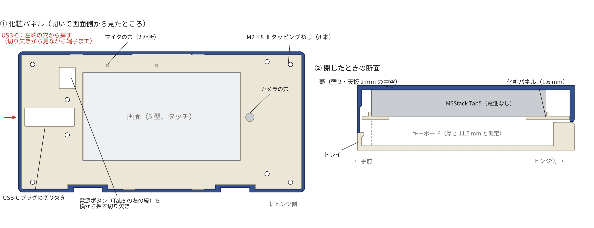
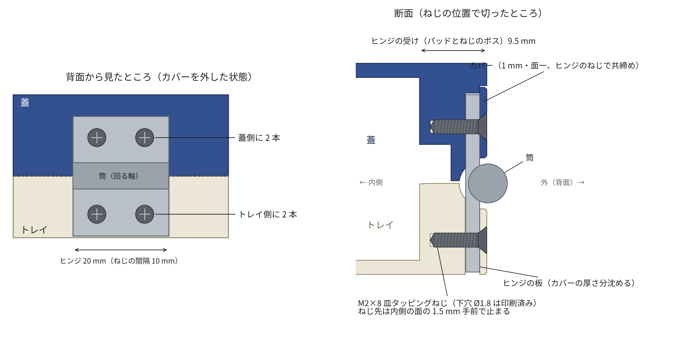
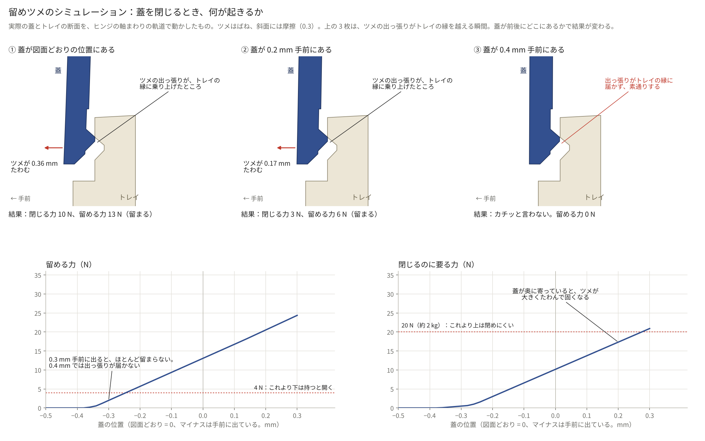

# Tab5 PDA Terminal: the enclosure

A clamshell for an **M5Stack Tab5** (in the lid) and a **CACOE keyboard** (in the tray), 3D-printed, with two Sugatsune
HG-MF08 torque hinges. It is a variant of the enclosure of
[PaperDIY PDA Terminal](https://github.com/tsuyoshi-otake/paperdiy-pda-terminal), which is itself derived from
[phone-enclosure](https://github.com/unkyulee/phone-enclosure) by Un Kyu Lee. Japanese overview: [../README.md](../README.md);
assembly: [ASSEMBLY_ja.md](ASSEMBLY_ja.md); parts list: [bom.csv](bom.csv).

**Status: designed, not printed.** The Tab5's dimensions are read from M5Stack's size drawing and housing model; nothing
has been checked against a real Tab5. The design this derives from has been built once; its latest changes (the relief
at the hinge side, the snap) are unprinted there too.

## Run

```sh
make setup     # pinned Python packages
make 3mf       # fetch the pinned original STLs, build all STLs (with fit and motion checks) and the print plates
make verify    # rebuild and compare with out/MANIFEST.json
make report    # needs prusa-slicer: print time, filament, hinge margin, tipping -> out/print_report.md
make sim       # the lid closing onto its snap, simulated on the built parts -> out/snap_sim.md
make render    # images (Node.js, Playwright's Chromium, matplotlib with a Japanese font)
```

Everything is rebuilt from `src/params.py` + `src/build.py`; `tools/manifest.py` records the hashes of what is committed
and CI (`.github/workflows/build.yml`) rebuilds and compares on every push.

## What is new against the PaperDIY version

The code is the PaperDIY version's with the Tab5 in the place of the PaperDIY Complete Kit, so the parameters keep their
`KIT_*` names: "the kit" in `params.py`, `build.py` and the build log is the Tab5. Code and parameters of the earlier
designs (bare PaperDIY, magnets, push-rods, panel-mount USB-C lids) are still in the files and are not built.

| | PaperDIY version | here |
| --- | --- | --- |
| device in the lid | Complete Kit 120 × 67 × 6.3 mm, 43 g | Tab5 128 × 80 × 12 mm, 120.9 g (no battery) |
| lid | top slopes, 23.8 / 26.4 mm closed | flat top, 29.8 mm closed (`kit_lid_top`: flat when the device needs more than the hinge) |
| window | 105 × 59.7 | 110.7 × 62.3 (+0.3 a side), centred in the lid; 0.6 mm off the Tab5's middle across |
| USB-C | left end, y −24, at the kit's front face | left end, y 0, 4.4…12.0 mm behind the screen face (`USB_CH`) |
| panel | KEY slot + guard, power slot, 6 screws | camera hole, 2 microphone holes, one slot beside the power button, 8 screws |
| snap's flex zone | to 2 mm below the ceiling | to 8 mm below the ceiling (the same 11.9 mm of height in a taller wall): 19.1 N/mm, strain 0.33 % at 0.40 mm |
| panel split (A1 mini) | x −74.2 | x −75.0 (clear of the power slot), panel B 173.8 mm |
| tray, hinges, covers, snap lip and groove, relief at the hinge side | | unchanged (the tray is the same part) |

### The Tab5 in the lid

Tab5 frame, seen from the screen: x to the right, y up. The size drawing is in first-angle projection (the view drawn to
the right of the front view is the left side), which the housing model confirms: the USB-A, USB-C, 3.5 mm jack, PORT.A
and the power button are on the **left** edge, the battery bay and the camera on the right, the speaker and the 1/4" nut
on the bottom edge. In the lid the Tab5 lies screen down with its left edge toward −x (the lid's left end) and its top
edge toward −y (the lid's front), so the screen is upright when the lid is open.

| read from | value | parameter |
| --- | --- | --- |
| size drawing, `Tab5.stl` | body 128.0 × 80.0 × 12.0, corner r 4 | `KIT_L`, `KIT_W`, `KIT_T`, `KIT_R` |
| size drawing | visible area x 6.0…116.4, y 9.8…71.4 (from the lower left) | `KIT_WIN_OFF` −2.8, `KIT_WIN_OFF_Y` −0.6; size = the 5" 16:9 active area |
| size drawing | camera Ø5, 4.45 from the right edge, half way up | `KIT_CAMERA` |
| size drawing | two microphone holes in the top bezel, 23.2 and 57.5 from the left, 3.3 below the top edge | `KIT_MICS` |
| size drawing (left side view) | USB-C centred 40 mm up, its centre about 3.8 mm from the back | `KIT_USB_Y` 0, `KIT_USB_Z` (6.6, 9.8) behind the screen face |
| size drawing (left side view) | power button 7.5…16.7 mm below the top edge | `KIT_PWR_CAP_Y` (−32.5, −23.3) |
| docs.m5stack.com | 120.9 g without battery | `KIT_MASS_G` |

The drawing is a bitmap; positions read from it are good to about ±0.5 mm. The least certain is the USB-C port's depth
(read from a 12 mm thick side view): the opening in the lid's end wall is 13 × 7.6 mm for a plug overmold of 12 × 6.5.

The Tab5 is held between the bezel panel (a 2 mm rim round it, 0.2 mm a side) and three ribs from the ceiling on its back
cover (`KIT_RIBS_X`, left of the battery bay), 0.2 mm behind it. Nothing uses its M3 threads.



### What the report says (`out/print_report.md`)

- **Hinges.** The lid side weighs 223 g (lid, panel, Tab5, half the hinges); its moment about the axis is at most
  0.111 N·m against 0.118…0.196 N·m of the two HG-MF08: 1.1× at the weak end of their tolerance. It holds, but a touch
  adds to it: a push at the middle of the screen the lid stands is 1.2…1.9 N at 120°, 0.7…1.5 N at 135°. Stiffer hinges
  need other seats; not drawn.
- **Tipping.** Lid on the table at 140°. The keyboard has to weigh 145 g for the device to stay upright up to there
  (97 g up to 120°). Not weighed.
- **Snap.** Simulated (`out/snap_sim.md`): 10 N to close and 13 N of hold with the lid where it was drawn, 6 N of hold
  with the lid 0.2 mm forward, none at 0.4 mm.
- **Print.** Plates 1–3: 160 g, 4 h 14 min (A1 mini, 0.4 nozzle, 0.2 layers, no supports); one-piece parts for a 220 mm
  bed: 159 g, 4 h 03 min.

### Not reachable in the lid

USB-A, the headphone jack, microSD, PORT.A, the side header, RS485, the tripod nut and the M5-Bus are inside the lid; the
speaker faces the inside of the lid. The NP-F550 battery does not fit (the Tab5 would be 26.7 mm thick). With the
keyboard's charge plug in the tray's back, the lid opens to 94°.

## Everything else

Hinge seats and covers, the snap and its simulation, the relief at the hinge side, the split parts with their splice
plates, the Bambu Studio projects, the coupons and the reproducibility checks are the PaperDIY version's and are
described in its [design notes](https://github.com/tsuyoshi-otake/paperdiy-pda-terminal/blob/main/cad/README.md).
The figures here are redrawn from this version's parts:





## Changes vs. the original (for the licence "indicate changes")

None of the original meshes is used. The lid is a new hollow part that follows the original's outline (corner radii
halved to 3 mm, no chamfers) and parting surface, with a flat top, hinge pads and bosses, panel bosses, ribs, a USB-C
opening and guides, the hinge mortises and a snap lip on a thinned zone of the front wall; the bezel panel is new
(window, rim, camera and microphone holes, finger slots, countersunk holes, snap bumps). The tray is a new thin shell
with the original tray's outline (r 3), parting, keyboard room (as the opening of a deck flush with the rim) and rear
opening, plus hinge pads and bosses and a recess + groove for the snap lip. New parts: 4 hinge covers, the splice plates
and the test coupons. The original's knob hinge, label and Palma-specific openings are not used.

## Sources of measured dimensions

* M5Stack Tab5 size drawing `C145_Model_Size_page_01.png` and port overview (docs page of the Tab5).
* `m5stack/M5_Hardware`, `Products/C145_Tab5/Structures/Tab5.stl` (MIT): body size, which edge carries what.
* Sugatsune HG-MF spec table and 3D viewer, original enclosure geometry: as in the PaperDIY version.

## Licence & attribution

Derived from **"The PDA Terminal" / phone-enclosure by Un Kyu Lee** (https://github.com/unkyulee/phone-enclosure),
licensed **CC BY-NC 4.0**. The models and the images made from them (`out/`, `3mf/`, `renders/`, `../docs/images/`) are
under the same licence, non-commercial use only: see [LICENSE.md](LICENSE.md). The scripts (`src/`, `tools/`) and the
documentation are under the repository's [MIT License](../LICENSE).
