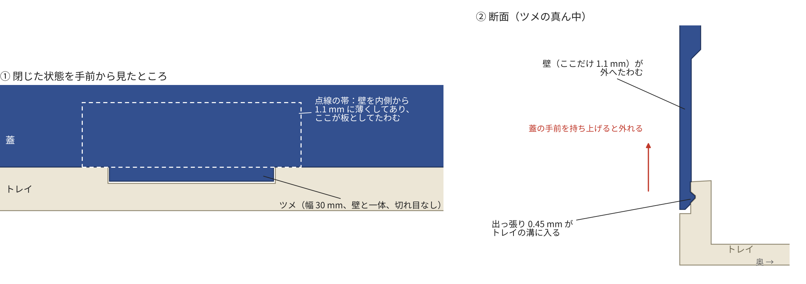

# Tab5 PDA Terminal: the enclosure

A clamshell for an **M5Stack Tab5** (in the lid) and a **CACOE keyboard** (in the tray), 3D-printed, with two Sugatsune
HG-MF08 torque hinges. It is a variant of the enclosure of
[PaperDIY PDA Terminal](https://github.com/tsuyoshi-otake/paperdiy-pda-terminal), which is itself derived from
[phone-enclosure](https://github.com/unkyulee/phone-enclosure) by Un Kyu Lee. Japanese overview: [../README.md](../README.md);
assembly: [ASSEMBLY_ja.md](ASSEMBLY_ja.md); parts list: [bom.csv](bom.csv).

**Status: designed, not printed.** The Tab5's dimensions are read from M5Stack's size drawing and housing model; nothing
has been checked against a real Tab5. The design this derives from has been built once; its latest changes (the relief
at the hinge side, the snap) are unprinted there too.

## Run

```sh
make setup     # pinned Python packages
make 3mf       # fetch the pinned original STLs, build all STLs (with fit and motion checks) and the print plates
make verify    # rebuild and compare with out/MANIFEST.json
make report    # needs prusa-slicer: print time, filament, hinge margin, tipping -> out/print_report.md
make sim       # the lid closing onto its snap, simulated on the built parts -> out/snap_sim.md
make render    # images (Node.js, Playwright's Chromium, matplotlib with a Japanese font)
```

Everything is rebuilt from `src/params.py` + `src/build.py`; `tools/manifest.py` records the hashes of what is committed
and CI (`.github/workflows/build.yml`) rebuilds and compares on every push.

## What is new against the PaperDIY version

The code is the PaperDIY version's with the Tab5 in the place of the PaperDIY Complete Kit, so the parameters keep their
`KIT_*` names: "the kit" in `params.py`, `build.py` and the build log is the Tab5. Code and parameters of the earlier
designs (bare PaperDIY, magnets, push-rods, panel-mount USB-C lids) are still in the files and are not built.

| | PaperDIY version | here |
| --- | --- | --- |
| device in the lid | Complete Kit 120 × 67 × 6.3 mm, 43 g | Tab5 128 × 80 × 12 mm, 120.9 g (no battery) |
| lid | top slopes, 23.8 / 26.4 mm closed | flat top, 29.8 mm closed (`kit_lid_top`: flat when the device needs more than the hinge) |
| window | 105 × 59.7 | 110.7 × 62.3 (+0.3 a side), centred in the lid; 0.6 mm off the Tab5's middle across |
| ports | USB-C at the left end, y −24, at the kit's front face | a **port bay** left of the Tab5: power button, USB-A, USB-C, headset jack and Grove reachable through the panel; one USB-C-sized opening in the left end wall, in line with the USB-C port, through which all the cables leave (`KIT_PORTS`, `PORT_BAY`; below) |
| panel | KEY slot + guard, power slot, 6 screws | camera hole, 2 microphone holes, the port bay's opening (a rectangle in line with the window, closed by a cover held by a tongue and a latch; no separate power slot), 4 screws (corners) + 2 pillars without a screw right of the Tab5 (`PANEL_PILLARS`) |
| snap's flex zone | to 2 mm below the ceiling | to 8 mm below the ceiling (the same 11.9 mm of height in a taller wall): 19.1 N/mm, strain 0.33 % at 0.40 mm |
| split (A1 mini) | lid x −72, panel x −74.2 (left ends) | lid and panel both at x +72 (right ends, so the port bay is in one piece with a whole ceiling; in line, so the seam is one line from the screen side); one splice plate each; the tray still at x −72 |
| tray, hinges, snap lip and groove, relief at the hinge side | | unchanged (the tray is the same part); no hinge covers in either version since 2026-11-15 |

### The Tab5 in the lid

Tab5 frame, seen from the screen: x to the right, y up. The size drawing is in first-angle projection (the view drawn to
the right of the front view is the left side), which the housing model and the pin map confirm: the power button, USB-A, USB-C, 3.5 mm
headset jack and PORT.A (Grove) are on the **left** edge, in that order from the top, the battery bay and the camera on the right, the speaker and the 1/4" nut
on the bottom edge. In the lid the Tab5 lies screen down with its left edge toward −x (the lid's left end) and its top
edge toward −y (the lid's front), so the screen is upright when the lid is open.

| read from | value | parameter |
| --- | --- | --- |
| size drawing, `Tab5.stl` | body 128.0 × 80.0 × 12.0, corner r 4 | `KIT_L`, `KIT_W`, `KIT_T`, `KIT_R` |
| size drawing | visible area x 6.0…116.4, y 9.8…71.4 (from the lower left) | `KIT_WIN_OFF` −2.8, `KIT_WIN_OFF_Y` −0.6; size = the 5" 16:9 active area |
| size drawing | camera Ø5, 4.45 from the right edge, half way up | `KIT_CAMERA` |
| size drawing | two microphone holes in the top bezel, 23.2 and 57.5 from the left, 3.3 below the top edge | `KIT_MICS` |
| `Tab5.stl`, size drawing (left side view) | USB-C opening 36.7…45.1 mm from the bottom edge, 7.2…9.7 behind the screen face | `KIT_USB_Y` 0, `KIT_USB_Z` (7.2, 9.7) |
| size drawing (left side view) | power button 7.5…16.7 mm below the top edge (`Tab5.stl`: 8.0…16.0) | `KIT_PWR_CAP_Y` (−32.5, −23.3) |
| size drawing (left side view) | USB-A receptacle 19.0…31.1 mm below the top edge, its shell from the back face to 5.2 behind the screen | `KIT_PORTS` usb_a: y −15.0, axis 8.6 behind the screen face |
| size drawing (left side view) | headset jack: round opening Ø6.2, 53.0 below the top edge, its centre 3 mm in front of the back face | `KIT_PORTS` jack: y 13.0, axis 9.0 |
| size drawing (left side view) | Grove (HY2.0-4P): 4 pins at 2 mm pitch round 66.0 below the top edge, 9.0 behind the screen face | `KIT_PORTS` grove: y 26.0, axis 9.3 |
| docs.m5stack.com | 120.9 g without battery | `KIT_MASS_G` |

The drawing is a bitmap (9.84 px/mm along the edge); positions read from it are good to about ±0.5 mm, read at the
centres of its lines. Where the housing model has the same feature (the power button's opening, the USB-C) the two agree
to 0.4 mm; the housing model has no openings for USB-A, the jack and Grove, so those three come from the drawing only.

The Tab5 is held between the bezel panel (a 2 mm rim round it, 0.2 mm a side) and three ribs from the ceiling on its back
cover (`KIT_RIBS_X`, left of the battery bay), 0.2 mm behind it. Nothing uses its M3 threads.


### The port bay

The Tab5's left edge (its ports) is 37.8 mm inside the lid's left end wall. That space is the **port bay**:

- **Panel**: a plain rectangle, x −91.85…−62.60, y −32.05…30.85 (29.25 × 62.9 mm, `port_bay_rect`): the window's top and
  bottom edges, its right edge at the rim round the Tab5 (kept), 6.95 mm from the window and as far from the panel's
  left edge. Its front 1.0 mm is the rectangle; over the panel's back 0.6 mm it narrows 0.6 mm a side at 45° (the
  seat the cover rests on; `port_bay_panel_cut`). Until 2026-11-16 that was a flat ledge reaching 1.2 mm in: printed
  face down it hung in mid-air, sagged and strung, and the panel failed twice. The print report now looks for such
  overhangs on every part as it lies on its plate (none allowed).
- **Cover** (`build_port_cover`, `PORT_COVER`, printed with the panel, face down): a plate flush with the panel face
  filling the opening to its back (0.2 mm a side, a 0.6 mm chamfer round its face to get a fingernail under, its back
  edge bevelled onto the seat), a 1.0 mm frame on its back inside the seat down to 2 mm behind the screen face (clear
  of the plugs, which start at 4.1). Held like a battery cover (`PORT_COVER["hold"]`): along the right edge a tongue
  reaches 0.4 mm behind the panel's back (0.1 mm off it); at the middle of the left edge a 16 mm finger, cut free of the
  plate by a 0.8 mm slot (seen on the face), carries a 5 mm hook of the same profile. Both catch faces are at 45°, so
  they print face down without support. The finger springs 0.45 mm in to pass the seat (0.48 % strain, about 0.9 N),
  then clicks behind the panel. In: tongue first under the right edge, then press the left edge. Out: pull the left
  edge by the chamfer (the hook's 45° face pushes the finger in), then lift it off the tongue. Loose or tight: `tip`
  (0.2; the catch reaches `ledge - tip` behind the panel). The build checks that, pulled 0.5 mm out, both catches bear
  on the panel. It goes back on with the plugs in; the power button is in the bay too, so the cover comes off to
  press it.
- **End wall**: one opening (`port_openings`, `PORT_BAY["slot"] = "usb_c"`), the size of the USB-C plug + 0.5 mm a side
  and in line with the port: y −6.5…6.5, 4.7…12.2 mm behind the screen face (13.0 × 7.5 mm). In print (lid top down)
  its edge is a 13 mm bridge in the 2 mm wall: no supports. (Until 2026-11-15 one opening over all four plugs' lanes,
  56.5 × 8.9 mm: a bridge that wanted supports; `slot = True` brings it back.) A test coupon of the end wall
  (`coupon_port_end`, plate 0) shows whether the plugs pass.
- **Ceiling**: nothing hangs in the bay (no guide ribs, no pillars: fingers need the room). The ports sit near the
  Tab5's back, so a 16 × 8 USB-A overmold and a Ø7.5 headset plug stand 0.4–0.6 mm above it; over those lanes (and the
  USB-C one between them) the ceiling is thinned from inside to 1.2 mm, end wall to Tab5, which leaves them 0.4 and
  0.25 mm. The lid's height does not change.
- The USB-C plug goes straight through the opening into the port. The others go in through the bay with the cover off
  (28.0 mm across inside the seat; the 30 mm USB-A plug goes in tail first under the panel's left edge, which leaves
  35.8 mm), and their cables out through the same opening: the cable's far end (a USB-C plug, a Grove connector) is
  threaded out through it, or a headset plug in from outside. Between a plug's tail and the end wall the cables bend
  over to the opening: USB-A 7.8 mm to go 8.5 mm sideways (a thin, soft cable), headset 12.8 mm for 6.5, Grove 25.8 mm
  for 19.5. Three Ø4 cables fit side by side in it. Plugs to make room for (`KIT_PORTS` `plug`): USB-A 16 × 8 mm,
  USB-C 12 × 6.5, headset Ø7.5, Grove 10 × 5, all straight. With all four in, the nearest two are 1 mm apart. With the
  lid shut the bay faces the keyboard and the cables leave by the left end.
- The build checks each plug (the USB-C one with a Ø4 cable out through the wall) against the lid, the panel, the tray
  and the other plugs, and the cover against all of them and the Tab5 (`port_plugs`, `port_bay_log`).
- To keep the bay's ceiling whole, the A1 mini split of the lid and the panel moved to their right ends, both at
  x +72 (until 2026-11-15 the panel at +75: two lines 3 mm apart from the screen side; the panel moved, the lid did
  not). The panel's splice plate sits 3 mm on its main piece (its pocket stops 0.5 mm short of the rim round the Tab5)
  and 9 mm on the end piece. The two pillars right of the Tab5 are at x 78.5, clear of the lid's seam; their gussets
  stop 0.4 mm short of it. The piece files are named after
  their side (`piece_names`: `lid_A_right`, `panel_A_right`, `tray_A_left`).

The layer that closes the opening is a 13 mm bridge across it; PrusaSlicer leaves the outer 0.3 mm of the 2 mm wall's
faces to the layer above there (the report lists it): at worst a faint line along the opening's edge.

### What the report says (`out/print_report.md`)

- **Hinges.** No covers: the leaves sit flush in a 2.05 mm mortise in the back face, the screw heads in the leaves' own
  countersinks, and the axis is 1.15 mm outside the back face (0.15 with the covers there were). The lid side weighs
  221 g (lid, panel and cover, Tab5, half the hinges; no plugs); its moment about the axis is at most 0.112 N·m against
  0.118…0.196 N·m of the two HG-MF08: 1.1× at the weak end of their tolerance. It holds, but a touch adds to it: a push
  at the middle of the screen the lid stands is 1.1…1.8 N at 120°, 0.7…1.4 N at 135°. Stiffer hinges need other seats;
  not drawn.
- **Tipping.** Lid on the table at 143°. The keyboard has to weigh 157 g for the device to stay upright up to there
  (102 g up to 120°). Not weighed.
- **Snap.** Simulated (`out/snap_sim.md`): 10 N to close and 13 N of hold with the lid where it was drawn, 5 N of hold
  with the lid 0.2 mm forward, none at 0.4 mm.
- **Print.** Plates 1–3: 158 g, 4 h 03 min (A1 mini, 0.4 nozzle, 0.2 layers, no supports); one-piece parts for a 220 mm
  bed: 157 g, 3 h 52 min.

### Not reachable in the lid

microSD and the expansion header (bottom edge), RS485 and the other side's connectors, the tripod nut and the M5-Bus
are inside the lid; the speaker faces the inside of the lid. The NP-F550 battery does not fit (the Tab5 would be
26.7 mm thick). With the keyboard's charge plug in the tray's back, the lid opens to 98°.

## Everything else

Hinge seats, the snap and its simulation, the relief at the hinge side, the split parts with their splice
plates, the Bambu Studio projects, the coupons and the reproducibility checks are the PaperDIY version's and are
described in its [design notes](https://github.com/tsuyoshi-otake/paperdiy-pda-terminal/blob/main/cad/README.md).
The figures here are redrawn from this version's parts:





## Changes vs. the original (for the licence "indicate changes")

None of the original meshes is used. The lid is a new hollow part that follows the original's outline (corner radii
halved to 3 mm, no chamfers) and parting surface, with a flat top, hinge pads and bosses, panel bosses, ribs, an opening
for the cables in the left end wall, the hinge mortises and a snap lip on a thinned zone of the front wall; the bezel panel is new
(window, rim, camera and microphone holes, the port bay's opening with its ledge, countersunk holes, snap bumps). The tray is a new thin shell
with the original tray's outline (r 3), parting, keyboard room (as the opening of a deck flush with the rim) and rear
opening, plus hinge pads and bosses and a recess + groove for the snap lip. New parts: the port bay's cover,
the splice plates and the test coupons. The original's knob hinge, label and Palma-specific openings are not used.

## Sources of measured dimensions

* M5Stack Tab5 size drawing `C145_Model_Size_page_01.png` and pin map `C145_Pinmap_Overview.png` (docs page of the Tab5):
  the ports on the left edge and their order.
* `m5stack/M5_Hardware`, `Products/C145_Tab5/Structures/Tab5.stl` (MIT): body size, which face is the screen, the
  power button's and the USB-C's openings.
* Sugatsune HG-MF spec table and 3D viewer, original enclosure geometry: as in the PaperDIY version.

## Licence & attribution

Derived from **"The PDA Terminal" / phone-enclosure by Un Kyu Lee** (https://github.com/unkyulee/phone-enclosure),
licensed **CC BY-NC 4.0**. The models and the images made from them (`out/`, `3mf/`, `renders/`, `../docs/images/`) are
under the same licence, non-commercial use only: see [LICENSE.md](LICENSE.md). The scripts (`src/`, `tools/`) and the
documentation are under the repository's [MIT License](../LICENSE).
